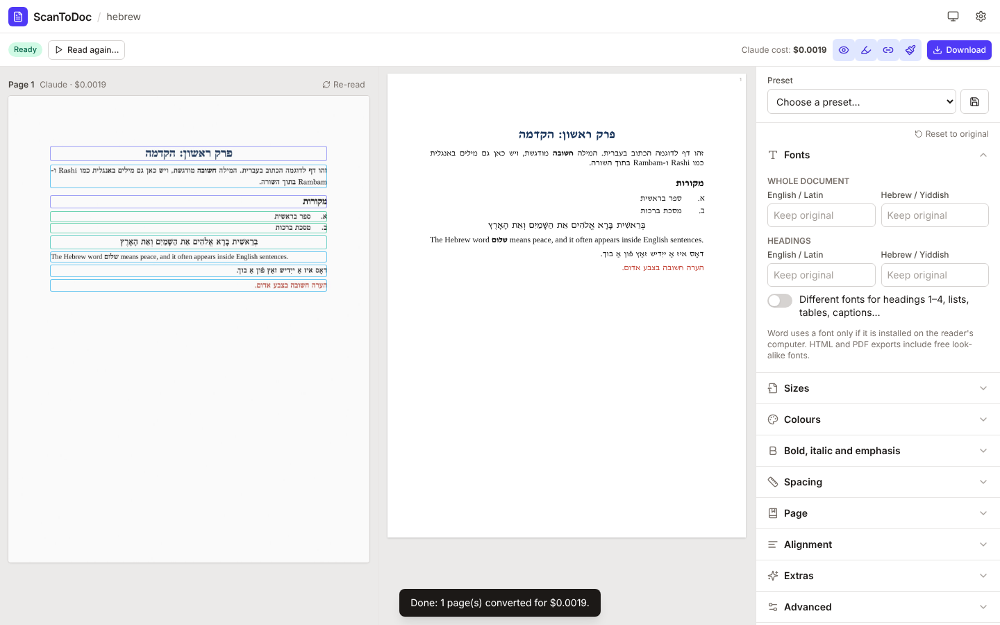
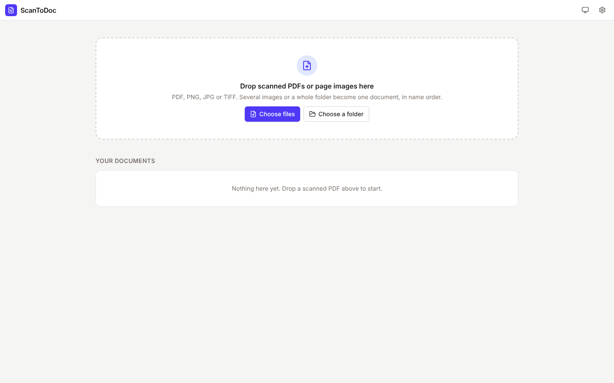
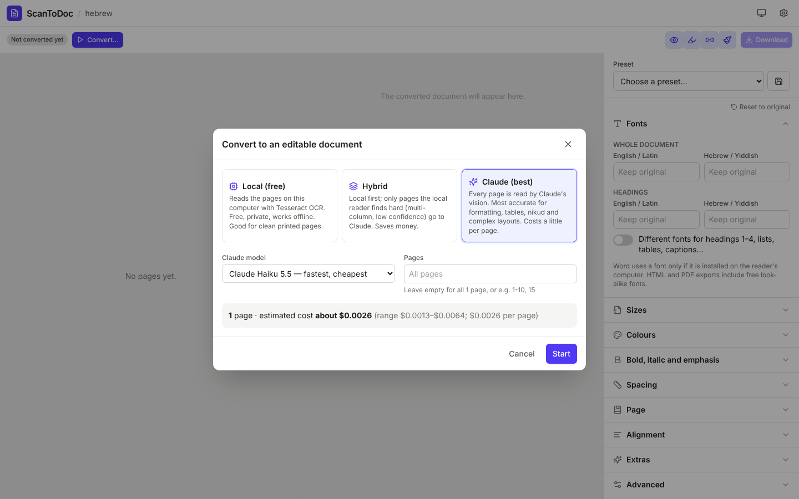
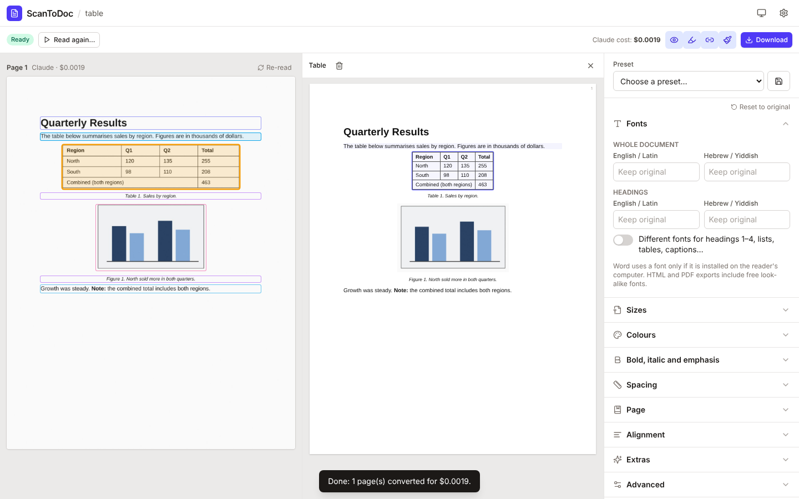
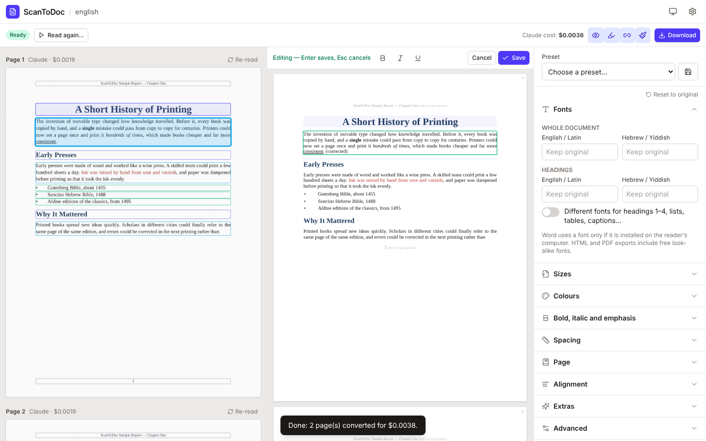
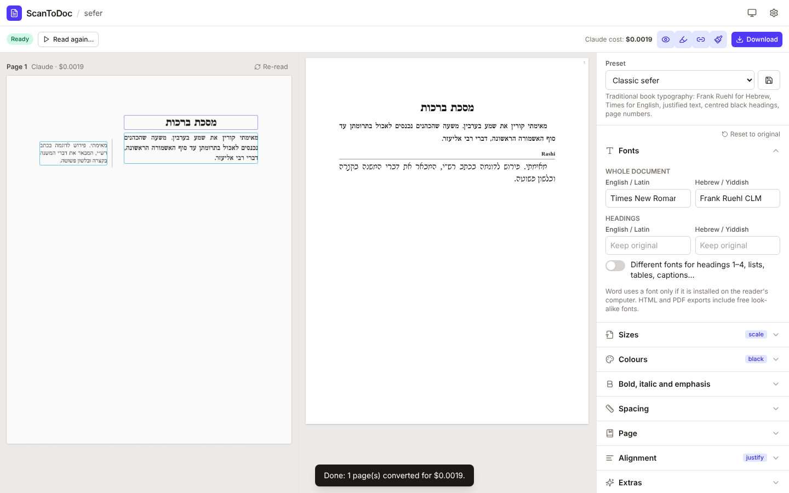
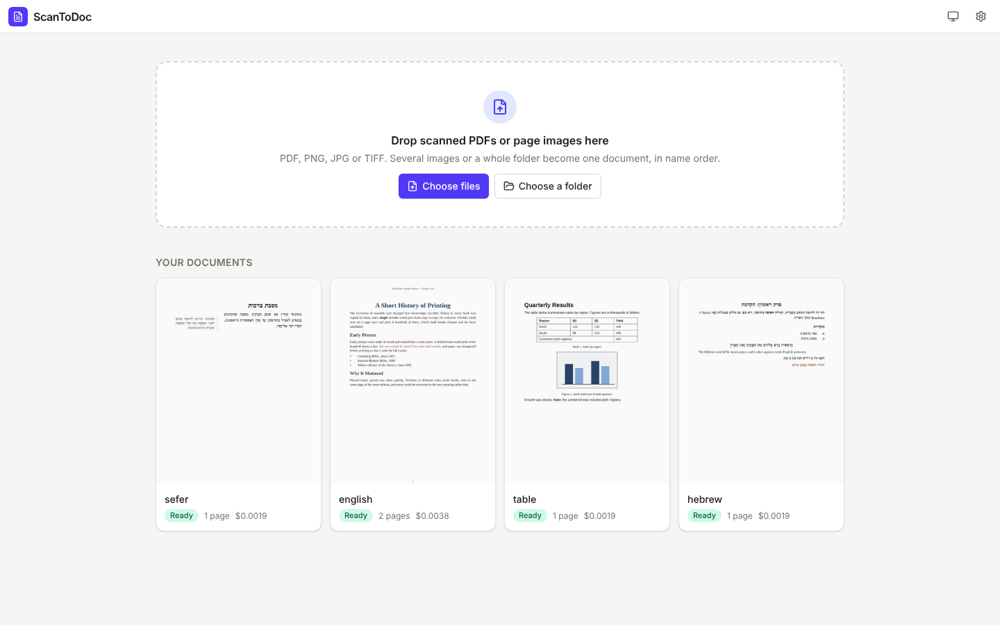
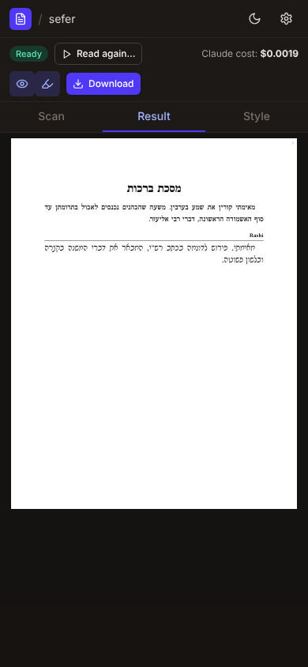

# ScanToDoc

**Turn scanned PDFs into documents you can edit.** You give ScanToDoc a scan: a PDF made of
page pictures, photos of pages, or a whole folder of them. It reads the pages and gives you a
proper Word file (or PDF, web page, Markdown or plain text). Headings become real headings,
and bold and italic, lists, tables (including merged cells), footnotes and pictures are all
kept. Hebrew, Yiddish and Aramaic are fully supported, including pages laid out like a Gemara
with Rashi and Tosafot around the main text.



ScanToDoc comes in three forms, all sharing the same engine:

- **An app in your web browser.** It runs only on your own computer. You drop a file, watch
  the pages being read, compare the scan with the result side by side, fix things and
  download. ([Start here](#1-install-and-start))
- **A command** for the terminal, for whole folders and automation. ([Commands](#5-the-command-line))
- **A Claude skill**, so you can just ask Claude to "make this scan an editable Word file".
  ([Claude skill](#6-use-it-from-claude))

---

## Contents

1. [Install and start](#1-install-and-start)
2. [Using the app](#2-using-the-app)
3. [Which reader should I choose?](#3-which-reader-should-i-choose)
4. [Optional extras: Tesseract, fonts, an API key](#4-optional-extras)
5. [The command line](#5-the-command-line)
6. [Use it from Claude (the skill)](#6-use-it-from-claude)
7. [Privacy](#7-privacy)
8. [If something goes wrong](#8-if-something-goes-wrong)
9. [For developers](#9-for-developers)

---

## 1. Install and start

You need **Python 3.10 or newer**. Python is a free program that ScanToDoc runs on. If you do
not have it, the start file opens the download page for you.

1. **Download ScanToDoc.** On [ScanToDoc's GitHub page](https://github.com/jellotoo/scantodoc),
   click the green **Code** button, then **Download ZIP**. Unzip the file (double-click it)
   and open the folder inside. You can move that folder anywhere you like, even after the
   first start.
2. **Start it.**
   - **Windows:** double-click **`start-windows.bat`**. If Windows shows "Windows protected
     your PC", click **More info**, then **Run anyway**.
     When installing Python, tick **"Add python.exe to PATH"** on the first screen of the
     installer.
   - **Mac:** double-click **`start-mac.command`**. If macOS says it cannot be opened, open
     **System Settings → Privacy & Security**, scroll down, click **Open Anyway** next to
     `start-mac.command`, and confirm. (On macOS 14 and older you can instead Control-click
     the file and choose **Open**.)
   - **Linux:** in a terminal, run `bash start-mac.command` (the same script works there).
3. **The first start takes a few minutes.** It sets everything up in a private folder
   (`ScanToDoc` in your home folder) and asks two questions: whether to install the free
   Hebrew fonts for Word (recommended), and, on a Mac with Homebrew, whether to install
   Tesseract. Then your web browser opens **http://localhost:8765**.
   Later starts take a few seconds.

Keep the black window open while you use ScanToDoc; closing it stops the app. If you
double-click the start file while ScanToDoc is already running, it just opens the browser
page again.

---

## 2. Using the app

### Start a document

Drag scanned PDFs or page images (PNG, JPG, TIFF) onto the page, or use **Choose files** or
**Choose a folder**. Several images, or a whole folder, become one document, in file-name
order.



### Convert

Choose how the pages are read (see [which reader](#3-which-reader-should-i-choose)). You can
also pick the languages on the pages, or convert only some pages (for example `1-10, 15`).
When Claude is chosen, the cost is estimated **before** anything is sent.



A bar shows each page as it is read. Pages appear in the result as soon as they are done.

### Check the result against the scan

The scan is on the left and the result in the middle; they scroll together, page by page.
Coloured outlines on the scan show what was found: headings, paragraphs, lists, tables,
pictures and captions. Click an outline, or a paragraph in the result, to select it.



Each page shows which reader read it and, for Claude, what it cost. To read a single
difficult page again, use **Re-read** above it. You can re-read it with Claude, or locally.

### Fix things

- **Double-click** any paragraph to correct its text. **Ctrl+B / Ctrl+I / Ctrl+U** (⌘ on a
  Mac) make text bold, italic or underlined. **Enter** saves and **Esc** cancels.
- With a block selected, the bar above the result lets you change it to another type: a
  paragraph, a heading (levels 1-4), a list item, a quote, a caption or a footnote. You can
  also change its alignment or direction (right-to-left or left-to-right), or delete it.
  **Undo** brings a deleted block back.
- The highlighter button marks words the reader was **unsure of**, so you know where to
  proofread.



Your corrections are saved automatically and are kept when you change the style.

### Style it

The panel on the right changes the look instantly. Nothing is read again, and it costs
nothing. You can change:

- **Fonts:** a separate English and Hebrew font for the whole document, for headings, or for
  each element (lists, tables, captions, footnotes...)
- **Sizes:** a percentage for everything, or exact sizes per element
- **Colours:** all black, heading colours, a background, or an accent line under or beside
  headings
- **Bold, italic and emphasis:** remove bold, italic or underline, or turn short bold lines
  into real headings
- **Spacing:** line spacing, space before and after paragraphs, first-line indent
- **Page:** paper size, orientation, margins, and 1-3 columns
- **Alignment:** keep it as scanned, justify, or align to the start of each line (left for
  English, right for Hebrew)
- **Extras:**
  - a table of contents, page numbers and a title page
  - whether to keep the scan's running heads and its own page numbers
  - whether to join paragraphs split by a page break
  - remove nikud or ta'amim
  - how Gemara-style pages are ordered: page by page, all main text first, or main text only

**Presets** set many of these at once. The built-in ones are *Keep original*, *Clean
modern*, *Classic sefer* and *Academic*. Save your own with the disk button.



### Download

**Download** offers:

| Format | What you get |
|---|---|
| Word (.docx) | Real Heading 1-4 styles (so Word's navigation pane and table of contents work), real tables and lists, right-to-left paragraphs |
| PDF | Made from the HTML version, with real, selectable and searchable text, not a picture |
| Web page (.html) | One file with its styles built in |
| Markdown (.md) | For notes apps and websites (a .zip when the document has pictures) |
| Text (.txt) | Just the words |
| ScanToDoc data (.json) | The full document, which can be styled again later |

### Everything else

- **Your documents** are listed on the start page, with their status and cost. Click one to
  open it again.

  

- **Settings** (gear icon): your Claude API key, and what is installed.
- **Light / dark / match computer**: the screen icon in the top-right corner.
- **Small screens:** on a phone-sized window the panes become tabs: *Scan*, *Result* and
  *Style*.



---

## 3. Which reader should I choose?

| Reader | Quality | Cost | Needs |
|---|---|---|---|
| **Local** (default) | Good for clean, printed, single-column pages | Free; nothing leaves your computer | [Tesseract](#install-tesseract) |
| **Hybrid** | Local first; only the pages Local finds hard go to Claude: low confidence, several columns or commentaries, or almost no text found | Usually a fraction of Claude's cost | Tesseract and an API key |
| **Claude** | Best: formatting, tables, nikud, Rashi script, Gemara layouts | Estimated about $0.003 a page with Claude Haiku 5.5 (the default), about $0.05 with Sonnet 5.5, $0.10 with Opus 5.5 | An [API key](#a-claude-api-key) |

The prices are estimates. The app shows its own estimate before you start, and the real
cost as it goes. Pages already read are remembered, so reading the same file again costs
nothing unless you tick *Read pages that are already done again*.

---

## 4. Optional extras

### Install Tesseract

Tesseract is the free reader that the Local and Hybrid options use.

- **Windows:** download the installer from
  [UB Mannheim's Tesseract page](https://github.com/UB-Mannheim/tesseract/wiki). While
  installing, open **Additional language data** and tick **Hebrew** (and **Yiddish** if
  you need it).
- **Mac:** install [Homebrew](https://brew.sh), then in Terminal run
  `brew install tesseract tesseract-lang`. The Mac start file offers to do this for you.
- **Linux (Debian/Ubuntu):**
  `sudo apt install tesseract-ocr tesseract-ocr-heb tesseract-ocr-yid`

Restart ScanToDoc afterwards. **Settings** shows whether Tesseract and its languages were
found.

### Fonts for Word

Word can only show a font that is installed on the computer opening the file. The start
file offers to install ScanToDoc's free fonts once:

- Hebrew: Frank Ruhl Libre, David Libre, Noto Rashi Hebrew, Noto Serif/Sans Hebrew, Alef
  and Heebo
- English: EB Garamond

PDF and HTML downloads always contain the fonts they need.

### A Claude API key

This is only needed for the *Claude* and *Hybrid* readers.

1. Create an account at the [Claude Console](https://platform.claude.com/) and add some
   credit under **Billing**.
2. Create a key on the [API keys](https://platform.claude.com/settings/keys) page.
3. In ScanToDoc, open **Settings** (gear icon), paste the key and click **Save**.

The key is stored only on your computer, in the file `ScanToDoc/.env` in your home folder.
It is never shown in or sent to the browser page. If you prefer, set the environment
variable `ANTHROPIC_API_KEY` instead.

---

## 5. The command line

The start file installs the `scantodoc` command into `ScanToDoc/venv`. To use it, open a
terminal and activate that environment:

- Mac/Linux: `source ~/ScanToDoc/venv/bin/activate`
- Windows: `%USERPROFILE%\ScanToDoc\venv\Scripts\activate`

Developers can instead install it with `pip install -e .` in this folder.

```bash
scantodoc convert book.pdf                                   # Word file next to book.pdf (free, local reader)
scantodoc convert book.pdf -f docx,pdf --preset "Classic sefer"
scantodoc convert book.pdf --reader claude --toc --page-numbers -y
scantodoc restyle ~/ScanToDoc/projects/book --body-font "EB Garamond" --size body=12 -f pdf
scantodoc batch ./scans -r -f docx -o ./converted            # every PDF in a folder (and sub-folders)
scantodoc estimate book.pdf --model claude-sonnet-5-5        # what Claude would cost; sends nothing
scantodoc serve                                              # the web app
scantodoc doctor                                             # what is installed
scantodoc preset list | fonts | projects
```

Every command explains all its options with `--help`, for example `scantodoc convert --help`.
The same text for every command is collected in
[skill/scantodoc/reference/options.md](skill/scantodoc/reference/options.md).

Everything you can set in the app's style panel is also an option here. Run
`scantodoc restyle` to change the style of a finished conversion; it never reads the pages
again.

---

## 6. Use it from Claude

The skill teaches Claude how to use ScanToDoc. Then you can simply say *"turn this scanned
PDF into a Word document"*, or *"restyle my sefer with Frank Ruhl and a table of
contents"*.

The skill can also have **Claude read the pages itself, right in the chat**. That gives you
Claude-quality reading without an API key; it counts toward your normal Claude usage
instead. This is practical up to about 30 pages, and it is also how the skill works in the
Claude app, where Tesseract is not available. Claude looks at each page image, writes down
what it sees in ScanToDoc's page format, and ScanToDoc builds and styles the document from
that.

### In Claude Code

Copy the folder `skill/scantodoc` into your personal skills folder:

- Mac/Linux: `~/.claude/skills/scantodoc`
- Windows: `%USERPROFILE%\.claude\skills\scantodoc`

Or unzip `skill/dist/scantodoc-skill.zip` there; it holds the same folder. Start a new
Claude Code session. Claude then uses the skill when you ask about scans, or you can type
`/scantodoc`. The first use installs ScanToDoc into `~/ScanToDoc/venv`, which takes a few
minutes.

### In the Claude app (claude.ai or the desktop app)

1. Turn on code execution: **Settings → Capabilities → "Create and edit files"**. Skills
   need it.
2. Go to **Customize → Skills**, click **+**, then **Create skill → Upload a skill**.
3. Upload **`skill/dist/scantodoc-skill.zip`**.
4. Upload a scanned PDF in a chat and ask Claude to convert it.

The skill needs Claude's sandbox to reach the Python package index (pypi.org). That is the
default for personal plans. On Team and Enterprise plans an owner may have turned network
access off. The Claude app has no Tesseract, so Claude reads the pages itself there. PDF
export may also be unavailable there (it needs a browser); ask for Word or HTML instead.
These steps follow Anthropic's help article
[Using Skills in Claude](https://support.claude.com/en/articles/12512180-using-skills-in-claude).
Menu names can change.

### What's in the skill

- `SKILL.md`: when to use it, how to choose a reader, every option and examples.
- `reference/page-format.md`: how Claude writes a page when it reads it in the chat.
- `reference/options.md`: the full `--help` of every command.
- `scripts/run.py`: runs any ScanToDoc command, installing ScanToDoc first if needed.
- `scripts/setup.py`: does that installation.

---

## 7. Privacy

- The app only listens to your own computer (`localhost`). It refuses requests that come
  from other websites, so a web page you visit cannot use ScanToDoc or your API key.
- With the **Local** reader nothing leaves your computer.
- With **Claude** or **Hybrid**, the page images that Claude reads are sent to Anthropic's
  API. Nothing else is sent.
- Projects are plain folders in `ScanToDoc/projects` in your home folder. Each holds a copy
  of your files, the page images, the document and the exports. Delete a project in the app,
  or just delete its folder.

---

## 8. If something goes wrong

- **Run `scantodoc doctor`** (or open **Settings** in the app). It lists what is missing
  and how to fix it.
- **"Tesseract OCR is not installed"**: [install Tesseract](#install-tesseract), or choose
  Claude.
- **Hebrew comes out as gibberish with Local**: the Hebrew language pack for Tesseract is
  missing. Tick Hebrew in the Windows installer, or install `tesseract-lang` on a Mac.
- **"No Chromium-based browser was found" when downloading a PDF**: install Google Chrome
  or Microsoft Edge, or run `python -m playwright install chromium` in the ScanToDoc
  environment. Or download Word and use *Save as PDF*.
- **Word shows a different font**: install the fonts (see [Fonts for Word](#fonts-for-word)),
  then restart Word.
- **"Claude rejected the API key"**: check the key on the Console's API keys page and save
  it again in Settings.
- **Something else is using port 8765**: start with `scantodoc serve --port 8800`.
- **Start over completely**: delete the `ScanToDoc/venv` folder in your home folder and
  double-click the start file again. Your projects are not affected.

---

## 9. For developers

```bash
pip install -e ".[dev]"
pytest                                     # uses stand-ins for Claude, never the real API
cd frontend && npm install && npm run build   # rebuilds src/scantodoc/web/static (committed)
python skill/build.py                      # refreshes reference/options.md and builds skill/dist/scantodoc-skill.zip
python docs/make_screenshots.py            # regenerates docs/screenshots
```

Layout:

```
src/scantodoc/
  engine/      reading pages: ingest (PDF/images -> 300 DPI), readers (local, text layer, Claude),
               pipeline (cache, parallel pages), normalize (headers, page-break merges), handoff (in-chat reading)
  model.py     the internal document model (JSON)
  style/       style options, presets, fonts; resolve() applies a style to the model
  export/      docx, html (+ PDF through Chromium), markdown, txt, json
  web/         FastAPI app; the built React interface is in web/static
  cli.py       the scantodoc command
frontend/      React + Tailwind source of the web interface
skill/         the Claude skill
tests/         tests and sample pages (English, Hebrew/English, a table, a Gemara-style page)
```

The Claude reader asks Claude for strict JSON matching a schema
(`engine/readers/claude.py`). It validates the reply and retries once with the error. Each
page's result is cached by image and settings, so nothing is paid for twice.
